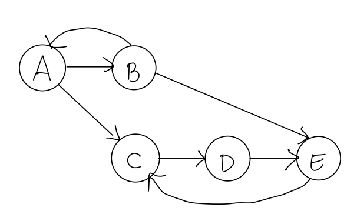

## Programming Assignment 10 Graphs (BFS and DFS)

### Implementation due Thu Dec 3 end-of-day

Submit via Gitlab

The framework for a graph implementation of Breadth-First Search and Depth-First Search as applied to different graphs has been provided.

The assignment is to do the following:

- Complete the traverse() method in Graph.java
- Complete the path() method in Graph.java
- Modify the sample graph to match the sample graph below.

Be sure to test both the puzzle and the sample graph when you are done.

Additionally, for the sample graph, try different start and goal states, including those for which there is no path.

